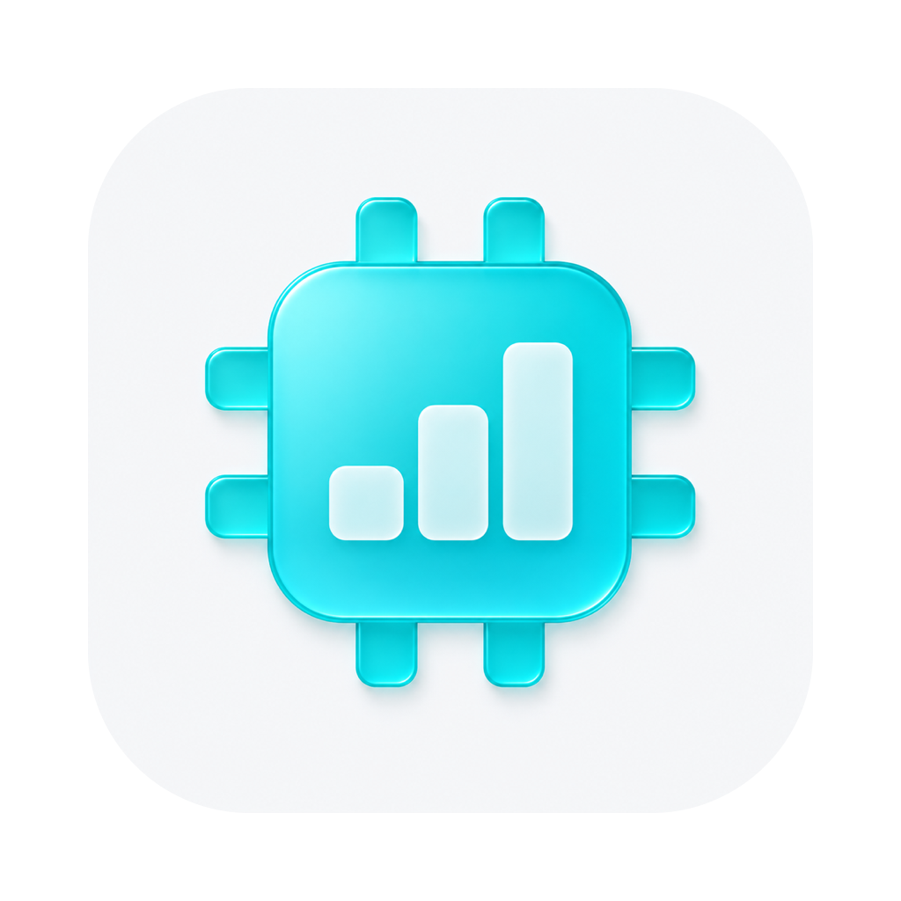
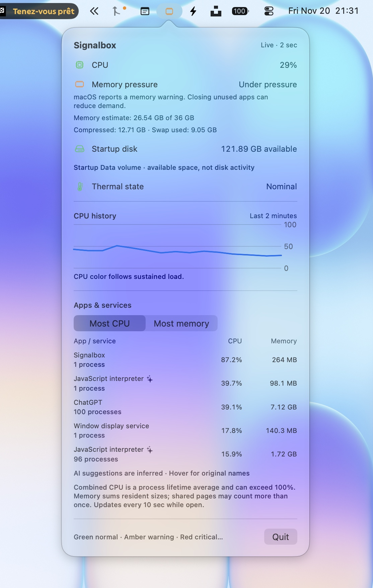

<p align="center">
  
</p>
<h1 align="center">Signalbox</h1>
<p align="center"><strong>A quiet system monitor for your Mac.</strong></p>
<p align="center">
  <a href="https://github.com/zackbraksa/signalbox/releases/download/v1.0.0/Signalbox-1.0.0-macOS.zip">Download Signalbox</a>
</p>
<p align="center">macOS 14 or later · Apple silicon and Intel</p>

Signalbox adds a color-only menu bar warning when CPU load, memory pressure, startup disk space, or thermal state needs attention. When everything is healthy, it stays out of the menu bar. Open Signalbox from Applications at any time to check the readings.

The details view shows a two-minute CPU history and the five apps or services using the most CPU or memory. Helpers are grouped under their parent app. Monitoring runs locally. On compatible Macs, Apple Intelligence can suggest labels for unfamiliar processes on-device.

<p align="center">
  
</p>

## Install

Unzip the download and drag Signalbox to Applications. View release notes on [Releases](https://github.com/zackbraksa/signalbox/releases).

## Build from source

Use Xcode 26 or later.

```sh
git clone https://github.com/zackbraksa/signalbox.git
cd signalbox
./script/build_and_run.sh --build
open dist/Signalbox.app
swift test --disable-sandbox --build-system native
```

## License

[MIT](LICENSE)
